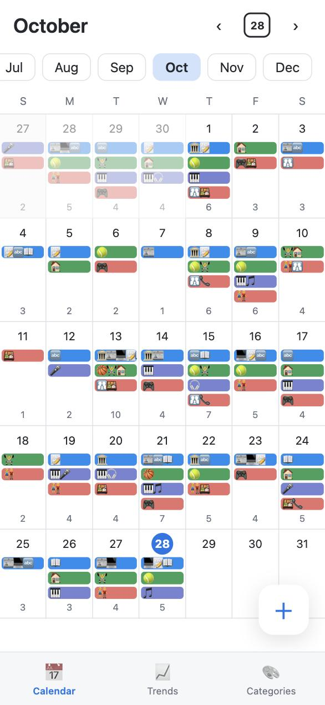
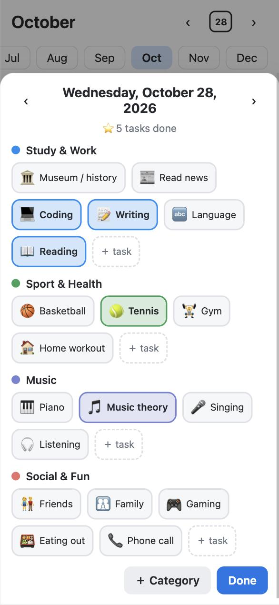
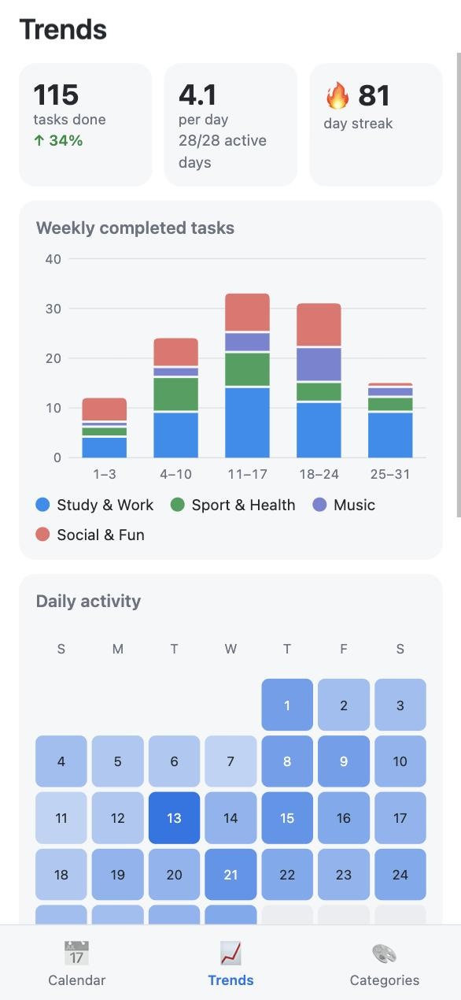
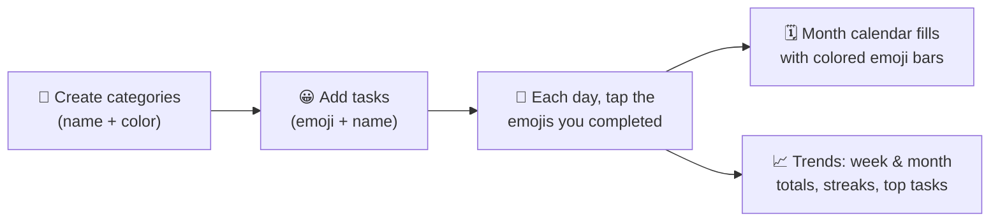
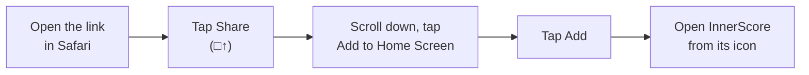
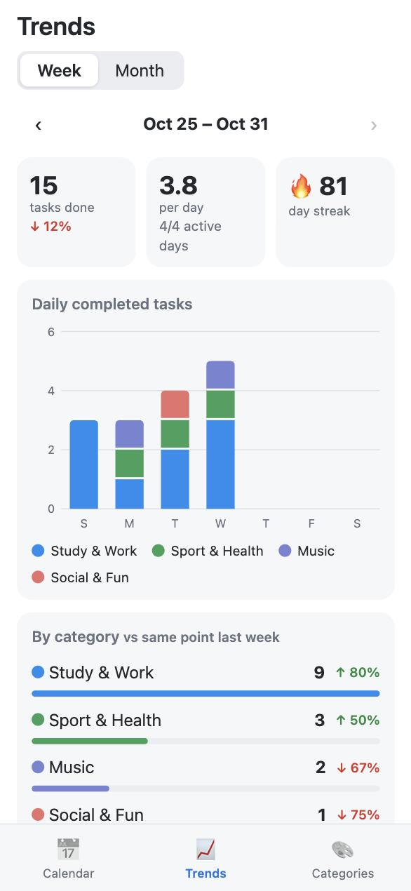
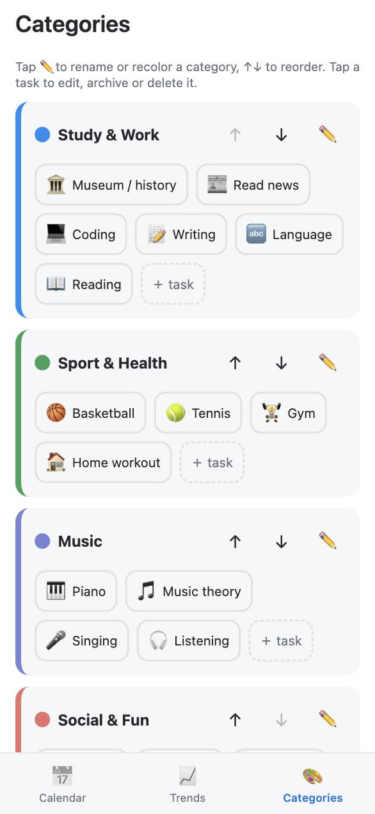
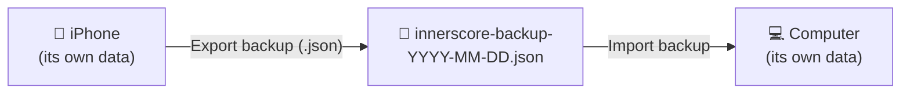

# InnerScore

**Log what you got done each day as emojis, grouped into colored categories, and see how your weeks and months are trending.**

InnerScore is a small, private web app. Each completed task is an emoji (🎹 piano, 🏀 basketball, 💻 coding …). Tasks belong to categories you create, each with its own color. The month calendar shows a colored bar per category per day, filled with that day's emojis, and the Trends tab shows your weekly and monthly totals, comparisons and streaks.

▶️ **Open the app:** https://hanlinl2022-ops.github.io/innerscore/

No account, no sign-up, no ads. Your data stays on your device.

<p align="center">
  
  &nbsp;
  
  &nbsp;
  
</p>

---

## Contents

- [How it works](#how-it-works)
- [Using InnerScore on each channel](#using-innerscore-on-each-channel)
  - [iPhone / iPad](#iphone--ipad-safari)
  - [Android](#android-chrome)
  - [Mac / Windows / Linux computer](#computer-chrome-edge-safari)
  - [Any other browser](#any-other-browser)
  - [Running it yourself](#running-it-yourself-developers)
- [Guide to the app](#guide-to-the-app)
- [Your data, backups and moving between devices](#your-data-backups-and-moving-between-devices)
- [FAQ](#faq)
- [Project structure](#project-structure)

---

## How it works



| Concept | What it is | Example |
|---|---|---|
| **Category** | A color-coded group of tasks | 🟦 Study & Work, 🟩 Sport & Health |
| **Task** | One emoji (plus an optional name) inside a category | 🎹 Piano, 📞 Phone call |
| **Log** | Which tasks you completed on a given day | Oct 28: 💻 📝 📖 🎾 🎵 |

The app starts with four example categories (Study & Work, Sport & Health, Music, Social & Fun) so you can try it right away. Rename, recolor or delete them to make it yours.

---

## Using InnerScore on each channel

InnerScore is a *Progressive Web App*: it runs in any modern browser, and on phones and computers it can be **installed** so it opens full-screen from its own icon, like a regular app, and keeps working offline.

| Channel | Best way to use it | Install? | Works offline after first visit |
|---|---|---|---|
| iPhone / iPad | Safari → Add to Home Screen | ✅ | ✅ |
| Android | Chrome → Install app | ✅ | ✅ |
| Mac / Windows / Linux | Chrome or Edge → Install, or Safari → Add to Dock | ✅ | ✅ |
| Any other browser | Just open the link | – | ✅ |
| Your own computer / server | Serve the folder with any static web server | – | ✅ |

### iPhone / iPad (Safari)



1. Open **https://hanlinl2022-ops.github.io/innerscore/** in **Safari**. (Recent iOS versions also offer Add to Home Screen in Chrome's share menu, but Safari is the most reliable.)
2. Tap the **Share** button (square with an up arrow) in the toolbar.
3. Scroll down and tap **Add to Home Screen**, then **Add**.
4. Open InnerScore from the new home-screen icon. It runs full-screen without Safari's address bar.

> 💡 Always open it from the icon. The installed app and a Safari tab keep **separate** data on iPhone.

### Android (Chrome)

1. Open **https://hanlinl2022-ops.github.io/innerscore/** in **Chrome**.
2. Tap the **⋮** menu → **Install app** (or **Add to Home screen**). Chrome may also show an install banner at the bottom.
3. Confirm with **Install**. InnerScore appears in your app drawer and home screen.

Samsung Internet, Edge and Firefox on Android have a similar **Add to Home screen** option in their menus.

### Computer (Chrome, Edge, Safari)

- **Chrome / Edge (Windows, Mac, Linux, ChromeOS):** open the link, then click the **install icon** (a monitor with a down arrow) at the right end of the address bar, or go to **⋮ → Cast, save and share → Install page as app** (Chrome) or **… → Apps → Install this site as an app** (Edge). It opens in its own window and shows up in your Start menu, Launchpad or Dock.
- **Safari on macOS Sonoma or later:** open the link, then **File → Add to Dock**.
- On wide screens the calendar shows larger cells and the day editor opens as a centered dialog.

### Any other browser

Simply visit the link and bookmark it. Everything works the same in the browser tab, including offline use after the first visit.

### Running it yourself (developers)

InnerScore is plain HTML, CSS and JavaScript with no build step and no dependencies, so any static file server works.

```bash
git clone https://github.com/hanlinl2022-ops/innerscore.git
```

```bash
cd innerscore && python3 -m http.server 5173
```

Then open http://localhost:5173. Opening `index.html` directly as a file won't work, because browsers don't allow JavaScript modules from `file://` URLs.

To host your own copy, push the folder to any static host (GitHub Pages, Netlify, Cloudflare Pages, Vercel, an S3 bucket …). It must be served over **HTTPS** (or `localhost`) for installing and offline mode to work.

---

## Guide to the app

The app has three tabs at the bottom: **Calendar**, **Trends** and **Categories**.

### 📅 Calendar: see your month at a glance


- Each day shows **one colored bar per category**, holding the emojis of the tasks you completed in it. The small number at the bottom is the day's total.
- Use the **month chips** (Jan … Dec) or the **‹ ›** arrows at the top to change month. The **date box** jumps back to today.
- Today is highlighted with a filled circle.
- **Tap any day** to open it and log or fix tasks, including past days.
- Tap the floating **＋** button to log **today**.

<br clear="right">

### ✅ Logging a day


- Every category is listed with its task emojis. **Tap an emoji to mark it done**; it fills with the category color. Tap again to undo.
- The ⭐ counter shows how many tasks you've done that day.
- **‹ ›** next to the date moves to the previous or next day, handy for catching up.
- **＋ task** adds a new emoji task to that category on the spot.
- **＋ Category** creates a new category without leaving the day.
- Everything saves instantly; **Done** just closes the panel.

<br clear="right">

### 📈 Trends: weekly and monthly

<p>
  
  &nbsp;
  
</p>

Switch between **Week** and **Month**, and use **‹ ›** to look at earlier periods.

| Section | What it shows |
|---|---|
| **Tasks done** | Total for the period, with ↑/↓ % compared to the previous period |
| **Per day** | Average tasks per day, and how many days you logged anything |
| **🔥 Day streak** | Consecutive days with at least one task, up to today |
| **Daily / Weekly completed tasks** | Stacked bar chart in your category colors: days of the week, or weeks of the month |
| **Daily activity** (month) | Heatmap of the month; darker means more tasks that day |
| **By category** | Each category's total, a bar to compare them, and its change vs the previous period |
| **Top tasks** | Your most-completed emojis in the period |
| **Last 12 weeks / months** | The long-term picture, stacked by category |

> 📏 **Fair comparisons:** while a week or month is still in progress, it's compared with the **same number of days** at the start of the previous one ("so far vs so far"), so a half-finished week doesn't look like a drop.

### 🎨 Categories: make it yours



- **＋ New category:** pick a name and a color (10 presets or any custom color).
- **✏️** renames, recolors or deletes a category.
- **↑ ↓** changes the order; the calendar bars and day editor follow this order.
- **Tap a task** to change its emoji, name or category, or to:
  - **Archive** it: hidden from the day editor, but kept in your history and trends.
  - **Delete** it: removed everywhere, including past days.
- **＋ task** adds a task. Use the quick-pick emojis or tap the emoji box and use your keyboard's emoji picker.

<br clear="right">

---

## Your data, backups and moving between devices



- **Everything is stored locally** in your browser on that device. Nothing is uploaded; there is no server or account.
- Each device, and each browser on it, has **its own separate copy**. Logging on your phone won't appear on your laptop automatically.
- **Back up regularly:** go to **Categories → Export backup**. This saves a `.json` file you can keep in Files, iCloud Drive, Google Drive, email, etc.
- **Move to another device / restore:** **Categories → Import backup** and choose the file. ⚠️ Importing **replaces** all data on that device.
- **Reset…** erases everything, and lets you start empty or with the example categories.

> ⚠️ Clearing your browser's website data (Safari: *Settings → Safari → Clear History and Website Data*), or uninstalling the app, also erases InnerScore's data. Export a backup first.

---

## FAQ

**Is my data private?**
Yes. It never leaves your device. The app is just static files; there is no backend, analytics or tracking.

**Does it work without internet?**
Yes, after you've opened it once. It caches itself for offline use.

**How do I get updates?**
Automatically. Open the app while online and it picks up the latest version.

**Can I log tasks for past days?**
Yes. Tap the day in the calendar, or use ‹ › in the day editor.

**Can a task count twice in one day?**
No. A task is either done or not done on a given day. If you want to track something twice, create a second task (e.g. 🏃 Morning run and 🌙 Evening run).

**Why is the week starting on Sunday?**
It matches the familiar calendar layout. Weeks run Sunday to Saturday in both the calendar and trends.

---

## Project structure

```
index.html            App shell: top bar, tab bar, bottom-sheet dialog
styles.css            Mobile-first styles, light & dark mode
manifest.webmanifest  PWA metadata (name, icon, colors)
sw.js                 Service worker for offline use
icon.svg              App icon
js/
  app.js              Tab routing and top bar
  store.js            Data model, localStorage persistence, export/import
  calendar.js         Month grid
  day.js              Day editor (toggle tasks)
  trends.js           Weekly/monthly stats and SVG charts
  categories.js       Manage categories, tasks and backups
  ui.js               Bottom sheet + task/category forms
  util.js             Date and formatting helpers
docs/screenshots/     Images used in this README
```

**Data model** (saved under the `innerscore.v1` key in `localStorage`, and in backup files):

```json
{
  "categories": [{ "id": "music", "name": "Music", "color": "#7b82d4" }],
  "tasks":      [{ "id": "k3j9x2", "categoryId": "music", "emoji": "🎹", "name": "Piano", "archived": false }],
  "log":        { "2026-10-28": ["k3j9x2"] }
}
```

**Deploying changes:** commit and push to `main`; GitHub Pages republishes within a minute. When you change app files, bump `CACHE` in `sw.js` (e.g. `innerscore-v2`) so installed copies refresh promptly.
